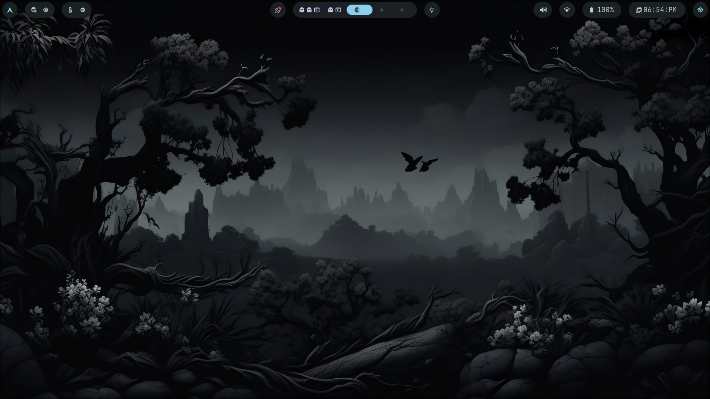

# Rafay's Hyprland Dotfiles — NIGHTWIRE



*NIGHTWIRE: terminal-HUD Hyprland rice on Arch. Lua-config entrypoint, modular across 9 files, with a shipped SDDM greeter, waybar in matugen-free phosphor-void, dunst + swaync + swayosd + btop + qt6ct + GTK all palette-matched.*

---

## What's in the box

| Component      | Config |
|----------------|--------|
| WM             | **Hyprland (Lua)** — `hyprland.lua` requires 9 modules, per-module pcall isolation |
| Bar            | **Waybar** — modular drawers, named workspaces, nightwire tokens |
| Notifications  | **SwayNC** control-center + **Dunst** popups |
| OSD            | **SwayOSD** — amber bezel for vol/brightness/caps |
| Terminal       | **Kitty** — phosphor-void 16-color palette, blurred bg |
| Shell          | **Fish + Starship** — two-line amber prompt, fastfetch on launch |
| Launcher       | **Wofi** — border-left selection indicator |
| Power menu     | `hypr/scripts/power-menu.sh` (wofi dmenu) |
| Cheatsheet     | `hypr/scripts/cheatsheet.sh` (SUPER+/ overlay) |
| File Manager   | Thunar + archive plugin |
| Wallpaper      | **swww + waypaper** — restores last pick on login |
| Lock           | **Hyprlock** — weekday + date + time, no hardcoded paths |
| Idle           | Hypridle — dim (25m) → lock (30m) → dpms (45m) |
| System monitor | **btop** — ships with `nightwire` theme |
| Login          | **SDDM** — ships `nightwire` QML greeter (pure QtQuick, Qt5/Qt6 both) |
| GTK / Qt       | `gtk-3.0/gtk.css` accent patches + `qt6ct` palette file |
| Cursor         | Bibata Modern Classic |
| Font           | JetBrainsMono Nerd Font |
| Fetch          | **Fastfetch** — hardware/software/desktop boxed layout |

---

## Install

Arch-based only (Arch, CachyOS, EndeavourOS, Manjaro, Garuda). **Hyprland 0.55+** for Lua config.

```bash
git clone https://github.com/Hirafay/Rafay-Hyprland-Arch
cd Rafay-Hyprland-Arch
chmod +x install.sh
./install.sh
```

Interactive menu:

```
  1) Install          (full rice)
  2) SDDM only        (just the greeter)
  3) Wallpaper only   (reset wall + waypaper state)
  4) Uninstall
  5) Help
  6) Quit
```

Install flow walks through: **dependency audit → preset picker (Minimal / Full / Dev) → AUR helper → packages → audio (optional) → backup (optional) → dotfiles → wallpapers + waypaper state → fish shell + cursor → SDDM + theme picker → services + user dirs**. Everything logs to `~/.cache/rafay-hyprland-install.log`.

### Unattended

```bash
RAFAY_UNATTENDED=1 RAFAY_PRESET=full ./install.sh install
```

Picks defaults for every prompt: Y to backup, Y to audio, Full preset, `nightwire` SDDM theme.

### CLI subcommands

```bash
./install.sh install          # same as the menu's option 1
./install.sh sddm             # just reinstall + configure SDDM
./install.sh wallpaper        # just reset wallpaper + waypaper state
./install.sh uninstall        # remove everything this installer put down
./install.sh help             # show full help
```

---

## Keybinds (headline set)

| Key | Action |
|---|---|
| `SUPER + Return` | Terminal |
| `SUPER + Space`  | Launcher |
| `SUPER + E`      | Files |
| `SUPER + B`      | Browser |
| `SUPER + V`      | Clipboard history |
| `SUPER + W`      | Wallpaper picker |
| `SUPER + X`      | Lock |
| `SUPER + /`      | Keybind cheatsheet |
| `SUPER SHIFT + P` | Power menu |
| `SUPER + F / G / P` | Float / fullscreen / pseudotile |
| `SUPER + Q`      | Close window |
| `SUPER + H/J/K/L` or arrows | Focus |
| `SUPER SHIFT + hjkl` | Move window |
| `SUPER CTRL + hjkl`  | Resize window |
| `SUPER + 1..9 / 0` | Workspace 1..10 |
| `SUPER SHIFT + 1..0` | Send window to workspace |
| `SUPER + A` | Scratchpad toggle |
| `SUPER SHIFT + A` | Send to scratchpad |
| `SUPER SHIFT + R` | Reload Hyprland |
| `SUPER SHIFT + N` | Toggle gaps on/off |
| `Print` / `SHIFT+Print` / `CTRL+Print` / `ALT+Print` | Screenshot region/full/window/pick-color |

Full list is in `hypr/keybinds.lua` and the SUPER+/ overlay.

### Submaps

| Enter | Mode | Keys |
|---|---|---|
| `SUPER + Y` | **resize**     | hjkl / arrows step 30px, c center, ESC/Enter exit |
| `SUPER + O` | **launch**     | b/t/c/f/d/s/o/g/m/n (browser/term/code/files/discord/spotify/obs/gimp/btop/nvim) |
| `SUPER SHIFT + X` | **screenshot** | a/w/s/c/d (area/window/screen/color/delay) |
| `SUPER SHIFT + G` | **group**      | g toggle, tab/h cycle, l lock, ESC exit |

---

## Named workspaces

```
1 sys · 2 web · 3 code · 4 chat · 5 media · 6 vm · 7 games · 8 art · 9 misc · special:magic
```

Apps auto-route to their home workspace via rules in `hypr/workspaces.lua`.

---

## File tree (after install)

```
~/.config/
  hypr/
    hyprland.lua           entry — requires all modules
    env.lua                environment vars
    monitors.lua           hl.monitor rules (fallback + examples)
    animations.lua         curves + animation tree
    settings.lua           general / decoration / input / misc / cursor / render / binds
    rules.lua              window + layer rules
    workspaces.lua         named workspaces + app routing
    autostart.lua          hl.on("hyprland.start", ...) — polkit, bar, swaync, swww, nm-applet, cliphist, swayosd
    submaps.lua            resize / launch / screenshot / group
    keybinds.lua           all binds (last require)
    hyprlock.conf          (hyprlang — lock screen)
    hypridle.conf          (hyprlang — idle daemon)
    wall.png               (copied from wallpapers/darkforest.png)
    hyprlock.png           (same, for the lock screen)
    scripts/
      power-menu.sh
      screenshot.sh
      cheatsheet.sh
    .luarc.json            LSP stub pointer (/usr/share/hypr/stubs)
  waybar/                  config.jsonc, style.css, modules/*.jsonc, tokens/*.css
  kitty/kitty.conf
  wofi/{config, style.css}
  fish/{config.fish, fish_variables}
  fastfetch/config.jsonc
  dunst/dunstrc
  swaync/{config.json, style.css}
  swayosd/style.css
  qt6ct/{qt6ct.conf, colors/nightwire.conf}
  gtk-3.0/{settings.ini, gtk.css}
  btop/{btop.conf, themes/nightwire.theme}
  waypaper/config.ini
  starship.toml
~/.icons/default/index.theme   (inherits Bibata-Modern-Classic)
~/Pictures/
  Wallpapers/darkforest.png
  Wallpapers/nightwire-preview.png
  Screenshots/
~/.face.icon                   (profile pic — seeded to the wallpaper)
```

---

## Wallpaper

Shipped: `wallpapers/darkforest.png` (= the signature dark-gothic forest shown in the preview) and `preview.png` (the whole-rice shot).

The installer copies both to `~/Pictures/Wallpapers/`, primes waypaper to remember `darkforest.png`, drops a copy at `~/.config/hypr/wall.png` (hyprlock + SDDM read this), and applies it live via `swww` if a Hyprland session is already running.

Change with `SUPER + W`. Waypaper persists the pick; swww applies it; autostart restores it next login.

---

## SDDM — NIGHTWIRE greeter

Ships at `sddm-theme/`. Installed to `/usr/share/sddm/themes/nightwire/` by the installer, with `/etc/sddm.conf.d/theme.conf` pointing at it.

The greeter is the showpiece of the rice:

- **Boot-log cold start** — fake kernel log scrolls on load, then clears to the login HUD
- **Matrix rain** canvas layer at 18% opacity behind the content
- **CRT scanlines** (animated, drifting) + vertical/horizontal vignette
- **Monster monospace clock** HH:MM:SS, live seconds, 160px bold phosphor
- **Box-drawing login frame** — `╡ NIGHTWIRE // auth-prompt ╞` header, `+` corner tick marks, ascii separators between fields
- **Prompt-style inputs** — `> login as [ rafay ]`, `> passwd : ●●●●`, `> session: [ Hyprland ]`
- **Blinking phosphor caret** on the password field
- **Keyboard shortcuts** — F1 cycles session, F2 cycles user, ESC clears, ENTER submits
- **Fail state** — red `>> ACCESS DENIED · retry_` + shake animation
- **Success state** — phosphor-flood flash overlay

Pure QtQuick — no `SddmComponents 2.0` import, so it loads on both Qt5-SDDM (0.19.x) and Qt6-SDDM (0.21+). Deps installed by `install.sh`:
`qt6-svg qt6-declarative qt6-5compat qt6-virtualkeyboard qt6-multimedia qt6-shadertools qt6-wayland`

Four other themes are offered at install time (sugar-candy, astronaut, corners, keep default) — all cloned from upstream.

Reinstall just the greeter:

```bash
./install.sh sddm
```

---

## Scripts

Under `hypr/scripts/`:

| Script | What it does |
|---|---|
| `power-menu.sh` | Wofi power menu — shutdown / suspend / reboot / logout / lock |
| `screenshot.sh` | `area \| screen \| window \| delay \| color` — unified router (grim + slurp + hyprpicker) |
| `cheatsheet.sh` | Full keybind reference in a wofi overlay (SUPER+/) |

---

## Uninstall

```bash
./install.sh uninstall
```

Removes the dotfiles, the SDDM themes this installer put down, and the Hyprland-stack packages.

---

## License

MIT
